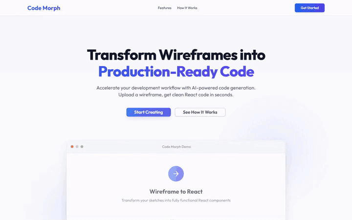
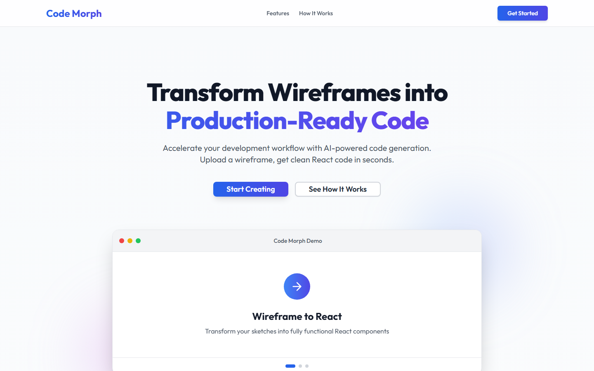
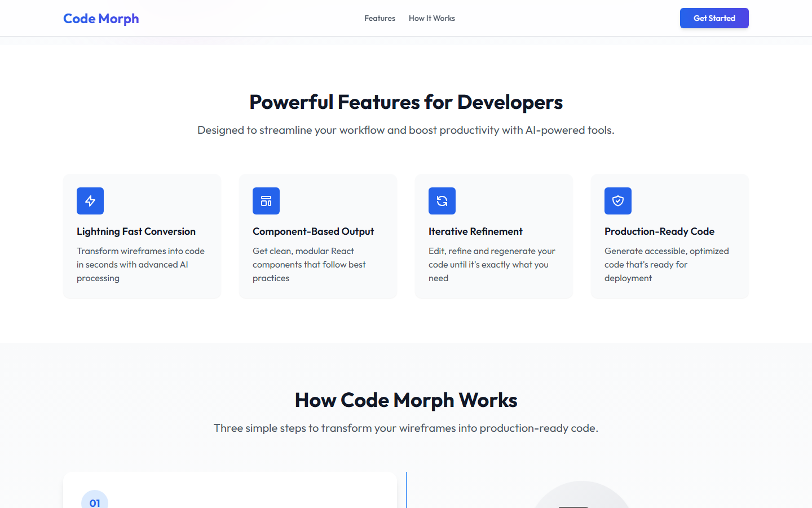
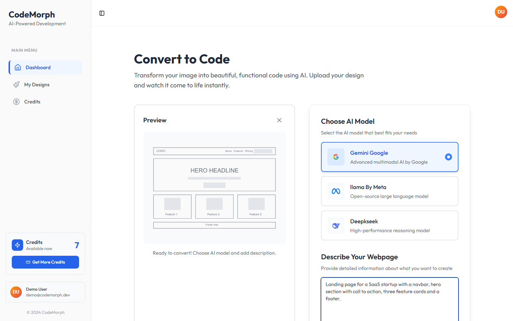
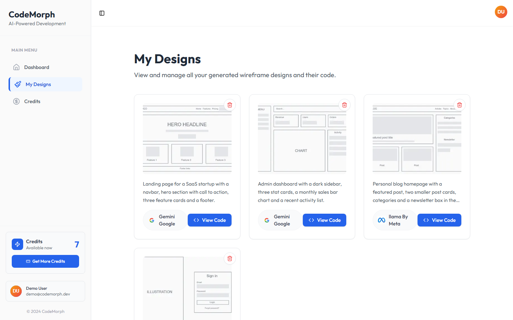
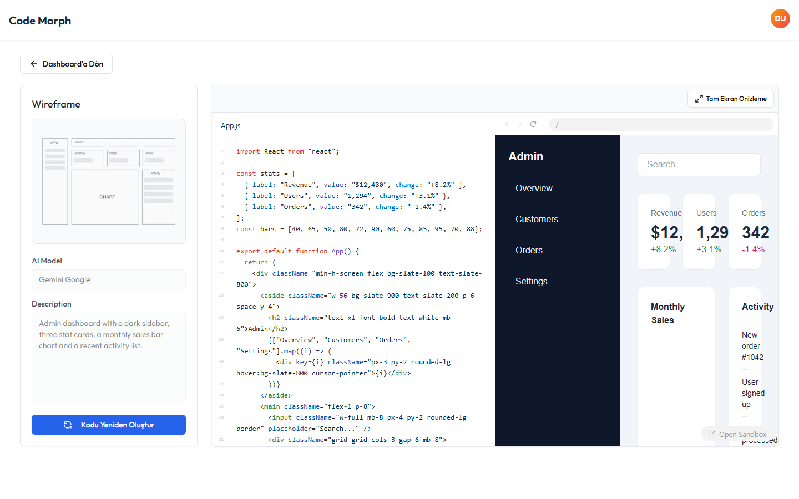
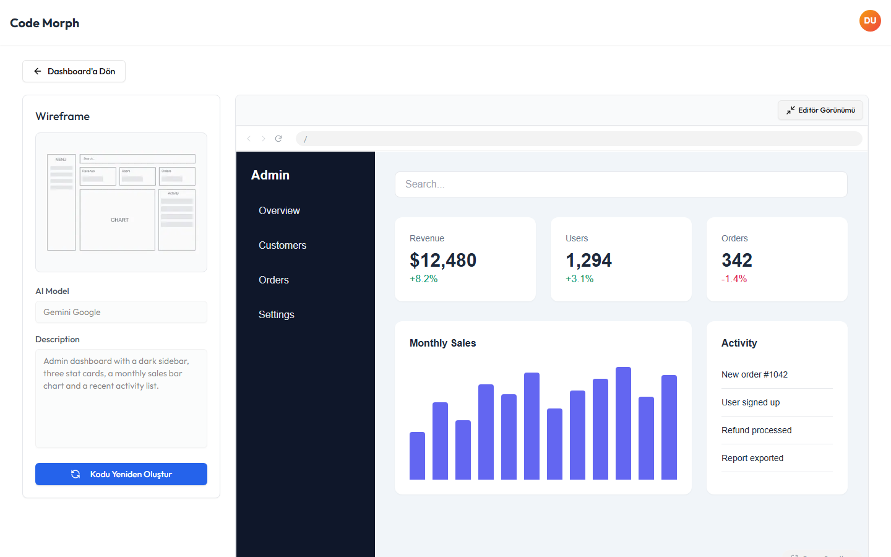
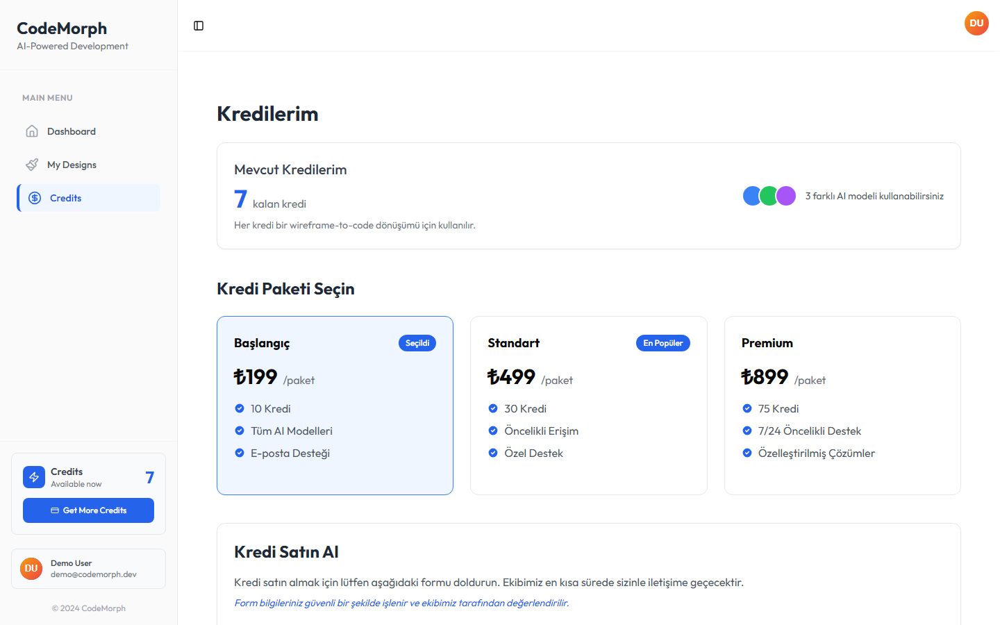
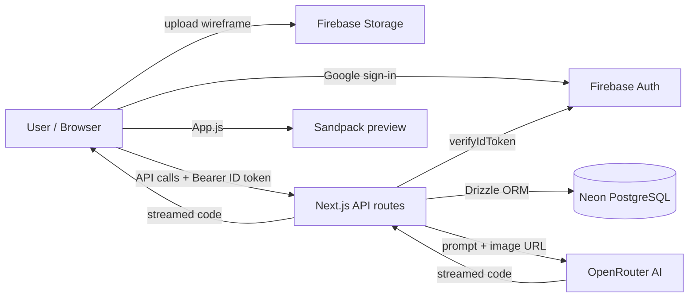

<p align="center">
  🇬🇧 English | <a href="README.tr.md">🇹🇷 Türkçe</a>
</p>

<p align="center">
  
</p>

<h1 align="center">Code Morph</h1>

<p align="center">
  Upload a wireframe, describe the page, and get a React + Tailwind CSS component generated by AI, with a live preview in the browser.
</p>

<p align="center">
  
</p>

<p align="center">
  
  
  
  
  
  
  
</p>

> **Note:** The interface is mostly in English, but some screens (the credits page and a few buttons and messages) are in Turkish.

## Demo

<p align="center">
  
</p>

▶️ [Watch the full-quality video (MP4)](docs/demo.mp4)

## Screenshots

| Landing page | Features |
| --- | --- |
|  |  |
| **Upload a wireframe** | **My designs** |
|  |  |
| **Code editor + preview** | **Full-screen preview** |
|  |  |
| **Credits** | |
|  | |

## Features

| Feature | Description |
| --- | --- |
| 🔐 Google sign-in | Firebase Authentication with a Google popup. Every API route checks the user's Firebase ID token on the server. |
| 🖼️ Wireframe upload | Pick an image, choose an AI model and describe the page. The image is uploaded to Firebase Storage under the user's own folder. |
| 🤖 AI code generation | The server builds the prompt from the saved record and streams the model's answer through OpenRouter. The code appears in the editor as it arrives. |
| 🧪 Live preview | The generated `App.js` runs in a Sandpack (CodeSandbox) editor with Tailwind, next to a live preview. There is also a full-screen preview mode. |
| 🔁 Regenerate | Generate the code again for the same wireframe and description. |
| 📁 My Designs | Lists the user's past conversions with the wireframe, description and model. Designs can be opened or deleted. |
| 💳 Credits | Each conversion costs 1 credit, deducted in a single atomic update. New users start with 0 credits. |
| 🧾 Credit packages | The credits page shows packages and a purchase request form. The form is a front-end mock: it saves the request to `localStorage` and does not take payments. Credits are added by an admin endpoint protected with `ADMIN_SECRET`. |
| ✨ Animated landing page | Hero, features and "how it works" sections built with Framer Motion. |

### AI models

The model picker shows three options. They map to these OpenRouter model IDs in [`data/Constants.tsx`](data/Constants.tsx):

| Label in UI | OpenRouter model |
| --- | --- |
| Gemini Google | `google/gemini-2.0-flash-001` |
| llama By Meta | `google/gemini-2.0-flash-001` |
| Deepkseek | `qwen/qwen-turbo` |

## Tech Stack

| Area | Technology |
| --- | --- |
| Framework | Next.js 15 (App Router), React 19, TypeScript |
| Styling | Tailwind CSS, shadcn/ui (Radix UI), Framer Motion, lucide-react |
| Authentication | Firebase Authentication (Google), firebase-admin for token verification |
| File storage | Firebase Storage |
| Database | Neon serverless PostgreSQL, Drizzle ORM |
| AI | OpenRouter through the `openai` SDK (streaming) |
| Code editor | Sandpack (`@codesandbox/sandpack-react`) |
| Other | axios, sonner (toasts), uuid4 |

## Architecture



**Conversion flow**

1. The user uploads a wireframe on `/dashboard`. The image goes to Firebase Storage.
2. `POST /api/wireframe-to-code` deducts 1 credit and saves the record (image URL, model, description).
3. `/view-code/[uid]` loads the record. If it has no code yet, it calls `POST /api/ai-model`.
4. The server streams the model output. When it finishes, the client saves the code with `PUT /api/wireframe-to-code`.

### API routes

| Route | Methods | Purpose |
| --- | --- | --- |
| `/api/user` | `GET`, `POST` | Get or create the signed-in user's record |
| `/api/wireframe-to-code` | `GET`, `POST`, `PUT`, `DELETE` | List, create, update and delete the user's own designs |
| `/api/ai-model` | `POST` | Stream generated code for one of the user's designs |
| `/api/purchase-credits` | `GET`, `POST` | Admin only (`x-admin-secret` header): view or add a user's credits |

## Project Structure

```
codemorph/
├── app/
│   ├── (routes)/                # Signed-in area with sidebar layout
│   │   ├── dashboard/           # Wireframe upload + model picker
│   │   ├── designs/             # "My Designs" list
│   │   └── credits/             # Credit balance and packages
│   ├── view-code/[uid]/         # Generated code editor and preview
│   ├── api/
│   │   ├── ai-model/            # Streams AI output from OpenRouter
│   │   ├── wireframe-to-code/   # Designs CRUD + credit deduction
│   │   ├── user/                # User record
│   │   └── purchase-credits/    # Admin credit top-up
│   ├── _components/             # Header, sidebar, auth, avatar
│   ├── layout.tsx
│   ├── page.tsx                 # Landing page
│   └── provider.tsx             # Auth context provider
├── components/ui/               # shadcn/ui components
├── configs/
│   ├── db.tsx                   # Drizzle + Neon connection
│   ├── firebaseConfig.tsx       # Firebase client (optional emulators)
│   └── schema.ts                # Database tables
├── data/Constants.tsx           # Prompt, model list, Sandpack dependencies
├── lib/
│   ├── api.ts                   # axios instance that sends the ID token
│   ├── auth.ts                  # Server-side token check
│   └── firebaseAdmin.ts         # firebase-admin setup
├── docs/                        # Logo, screenshots and demo video
└── drizzle.config.ts
```

## Getting Started

### Requirements

- Node.js 18.18 or newer
- A Firebase project with **Authentication (Google provider)** and **Storage** enabled
- A [Neon](https://neon.tech) PostgreSQL database
- An [OpenRouter](https://openrouter.ai) API key

### Setup

```bash
git clone https://github.com/LordAurora/codemorph.git
cd codemorph
npm install
```

Create a `.env` file in the project root (see below), then create the database tables:

```bash
npx drizzle-kit push
```

Start the development server:

```bash
npm run dev
```

Open [http://localhost:3000](http://localhost:3000).

> **Model icons:** the model picker expects `public/google.png`, `public/meta.png` and `public/deepseek.png`. These third-party logos are not included in the repository, so add your own images with those names.

### Environment variables

```env
# Database (Neon)
DATABASE_URL=

# AI (OpenRouter)
OPENROUTER_AI_API_KEY=

# Firebase client
NEXT_PUBLIC_FIREBASE_API_KEY=
NEXT_PUBLIC_FIREBASE_AUTH_DOMAIN=
NEXT_PUBLIC_FIREBASE_PROJECT_ID=
NEXT_PUBLIC_FIREBASE_STORAGE_BUCKET=
NEXT_PUBLIC_FIREBASE_MESSAGING_SENDER_ID=
NEXT_PUBLIC_FIREBASE_APP_ID=
NEXT_PUBLIC_FIREBASE_MESURMENT_ID=

# Server: token verification uses this project ID (defaults to NEXT_PUBLIC_FIREBASE_PROJECT_ID)
FIREBASE_PROJECT_ID=

# Secret for the admin-only /api/purchase-credits endpoint
ADMIN_SECRET=

# Optional: local Firebase emulators
NEXT_PUBLIC_FIREBASE_AUTH_EMULATOR_HOST=
NEXT_PUBLIC_FIREBASE_STORAGE_EMULATOR_HOST=
FIREBASE_AUTH_EMULATOR_HOST=
```

### Adding credits to a user

New users start with 0 credits. To add credits, call the admin endpoint:

```bash
curl -X POST http://localhost:3000/api/purchase-credits \
  -H "Content-Type: application/json" \
  -H "x-admin-secret: $ADMIN_SECRET" \
  -d '{"email": "user@example.com", "creditsToAdd": 10}'
```

## Scripts

| Command | Description |
| --- | --- |
| `npm run dev` | Start the development server |
| `npm run build` | Create a production build |
| `npm run start` | Run the production build |
| `npm run lint` | Run Next.js linting |
| `npx drizzle-kit push` | Create or update the database tables from `configs/schema.ts` |
