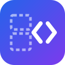
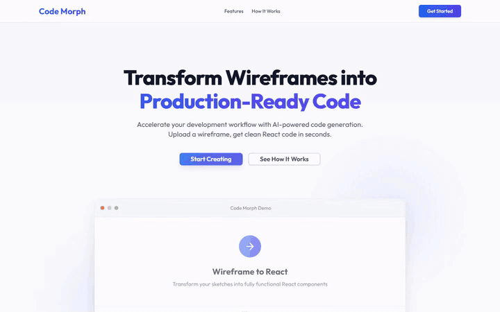
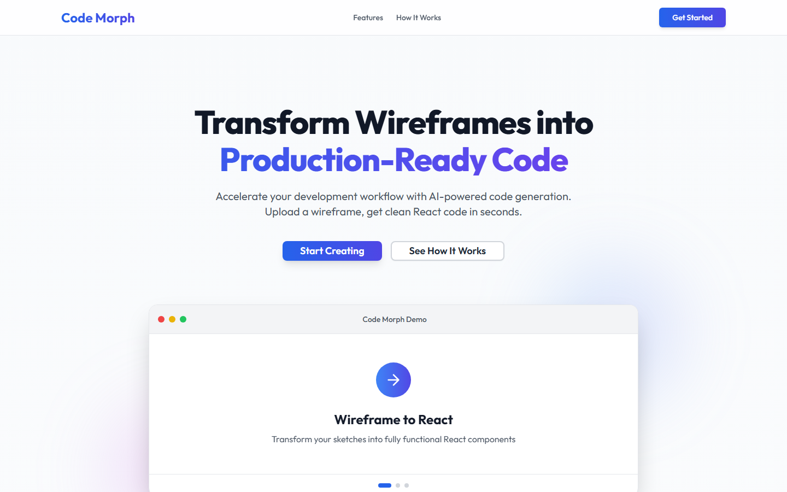
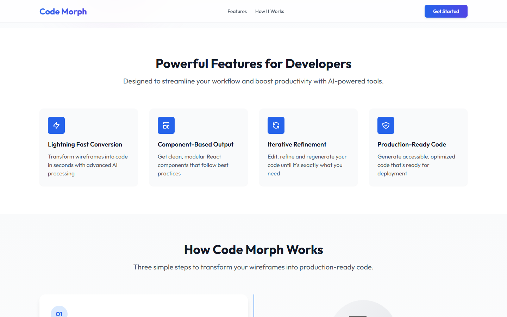
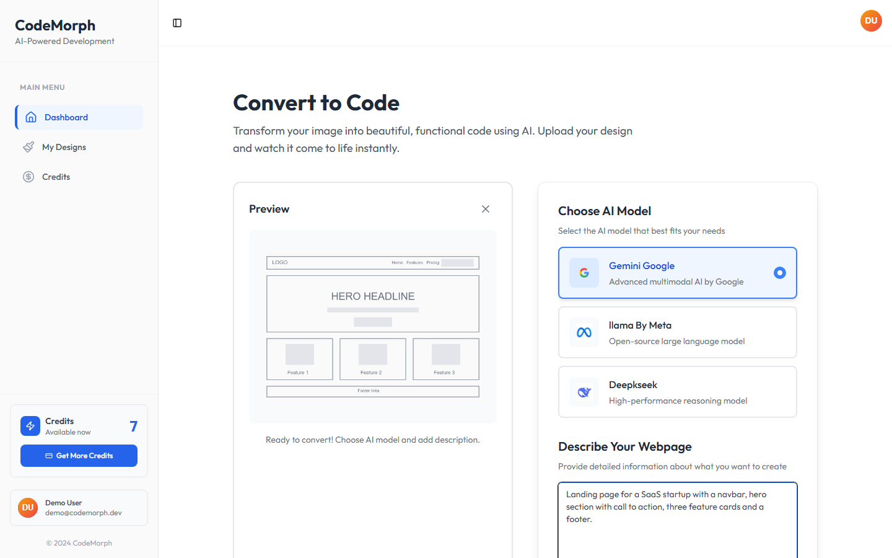
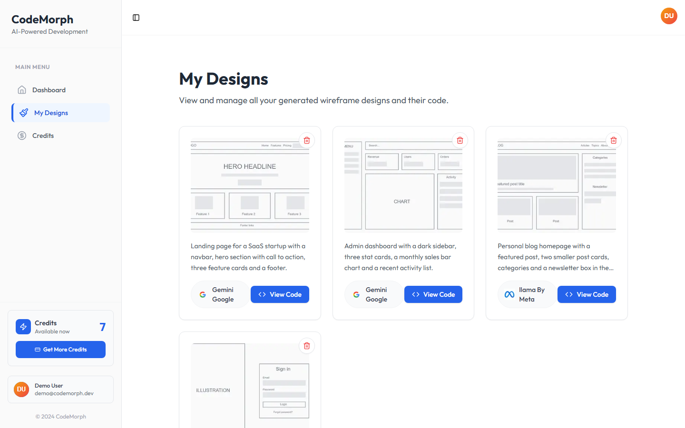
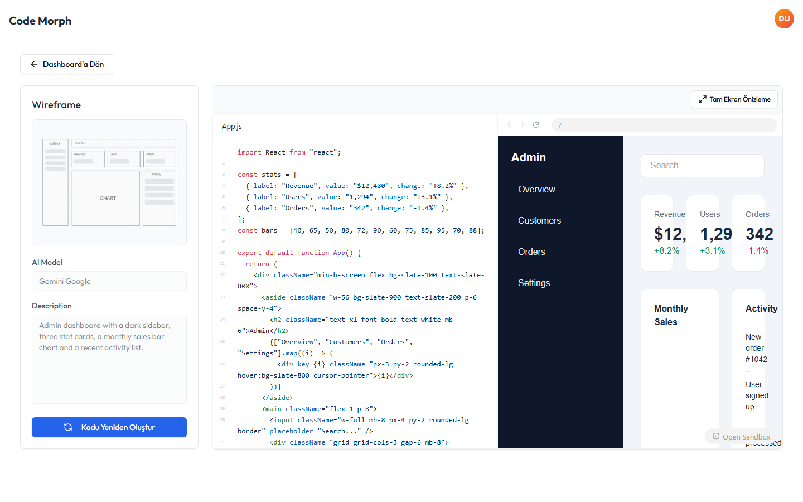
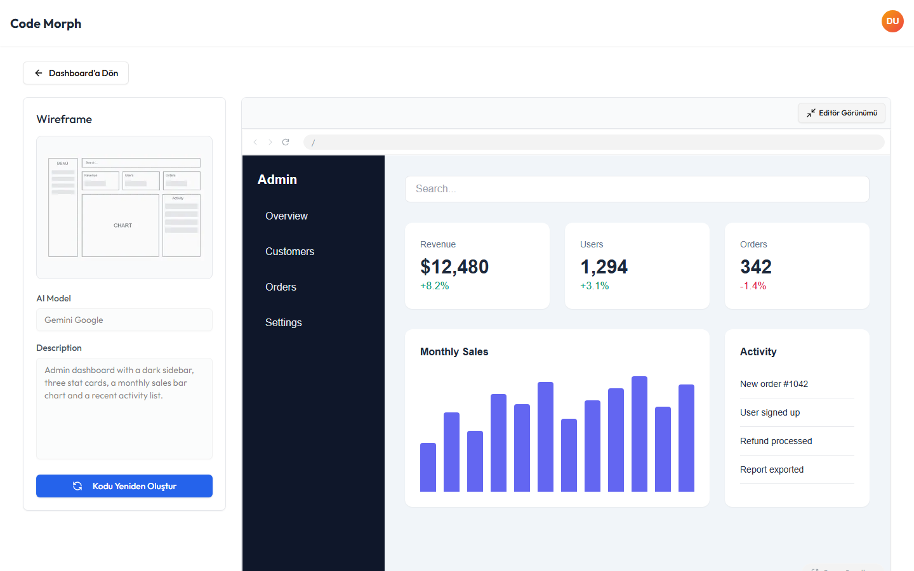
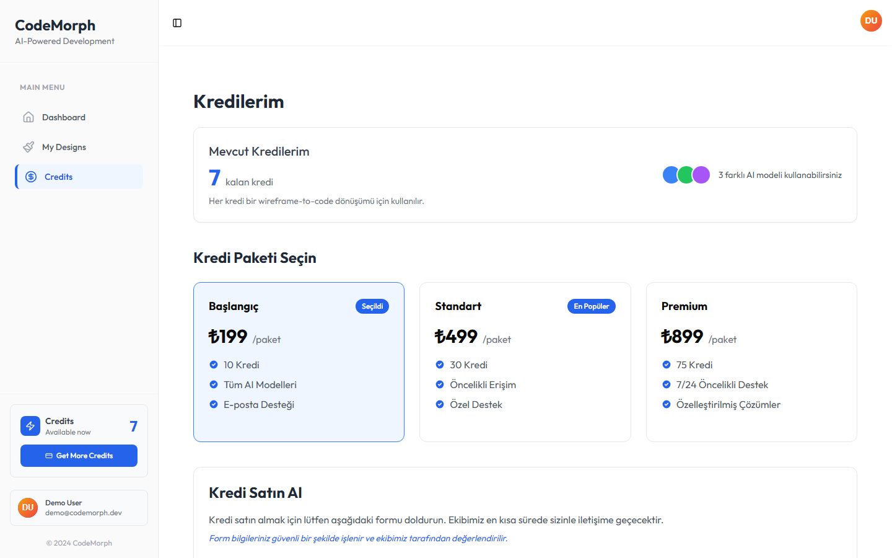
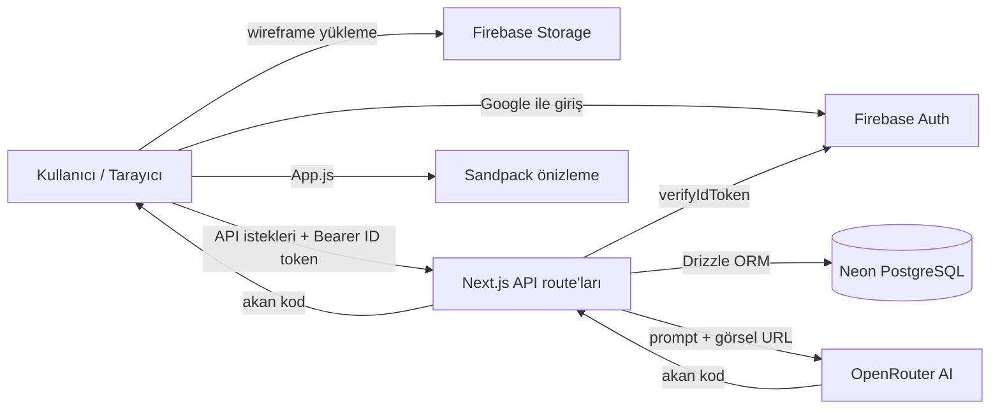

<p align="center">
  <a href="README.md">🇬🇧 English</a> | 🇹🇷 Türkçe
</p>

<p align="center">
  
</p>

<h1 align="center">Code Morph</h1>

<p align="center">
  Bir wireframe yükleyin, sayfayı tarif edin ve yapay zekânın ürettiği React + Tailwind CSS bileşenini tarayıcıda canlı önizlemeyle görün.
</p>

<p align="center">
  
</p>

<p align="center">
  
  
  
  
  
  
  
</p>

## Demo

<p align="center">
  
</p>

▶️ [Videoyu tam kalitede izle (MP4)](docs/demo.mp4)

## Ekran Görüntüleri

| Ana sayfa | Özellikler |
| --- | --- |
|  |  |
| **Wireframe yükleme** | **Tasarımlarım** |
|  |  |
| **Kod editörü + önizleme** | **Tam ekran önizleme** |
|  |  |
| **Krediler** | |
|  | |

## Özellikler

| Özellik | Açıklama |
| --- | --- |
| 🔐 Google ile giriş | Firebase Authentication ile Google popup girişi. Tüm API route'ları kullanıcının Firebase ID token'ını sunucuda doğrular. |
| 🖼️ Wireframe yükleme | Görsel seçilir, AI modeli belirlenir ve sayfa tarif edilir. Görsel, Firebase Storage'da kullanıcının kendi klasörüne yüklenir. |
| 🤖 AI ile kod üretimi | Sunucu, prompt'u kayıtlı tasarımdan oluşturur ve modelin cevabını OpenRouter üzerinden akış (stream) olarak gönderir. Kod editörde geldikçe görünür. |
| 🧪 Canlı önizleme | Üretilen `App.js`, Tailwind destekli bir Sandpack (CodeSandbox) editöründe canlı önizlemeyle çalışır. Tam ekran önizleme modu da var. |
| 🔁 Yeniden oluşturma | Aynı wireframe ve açıklama için kodu tekrar üretir. |
| 📁 Tasarımlarım | Kullanıcının önceki dönüşümlerini wireframe, açıklama ve modelle listeler. Tasarımlar açılabilir veya silinebilir. |
| 💳 Kredi sistemi | Her dönüşüm 1 kredi harcar; düşüm tek bir atomik sorguyla yapılır. Yeni kullanıcılar 0 krediyle başlar. |
| 🧾 Kredi paketleri | Kredi sayfasında paketler ve satın alma talep formu bulunur. Form sadece arayüz tarafında çalışır: talebi `localStorage`'a kaydeder, ödeme almaz. Krediler `ADMIN_SECRET` ile korunan admin endpoint'i üzerinden eklenir. |
| ✨ Animasyonlu ana sayfa | Framer Motion ile hero, özellikler ve "nasıl çalışır" bölümleri. |

### AI modelleri

Model seçicide üç seçenek var. [`data/Constants.tsx`](data/Constants.tsx) içinde şu OpenRouter modellerine bağlılar:

| Arayüzdeki ad | OpenRouter modeli |
| --- | --- |
| Gemini Google | `google/gemini-2.0-flash-001` |
| llama By Meta | `google/gemini-2.0-flash-001` |
| Deepkseek | `qwen/qwen-turbo` |

## Teknolojiler

| Alan | Teknoloji |
| --- | --- |
| Framework | Next.js 15 (App Router), React 19, TypeScript |
| Stil | Tailwind CSS, shadcn/ui (Radix UI), Framer Motion, lucide-react |
| Kimlik doğrulama | Firebase Authentication (Google), token doğrulama için firebase-admin |
| Dosya depolama | Firebase Storage |
| Veritabanı | Neon serverless PostgreSQL, Drizzle ORM |
| Yapay zekâ | `openai` SDK ile OpenRouter (streaming) |
| Kod editörü | Sandpack (`@codesandbox/sandpack-react`) |
| Diğer | axios, sonner (bildirimler), uuid4 |

## Mimari



**Dönüşüm akışı**

1. Kullanıcı `/dashboard` sayfasında wireframe yükler. Görsel Firebase Storage'a gider.
2. `POST /api/wireframe-to-code` 1 kredi düşer ve kaydı (görsel URL'si, model, açıklama) oluşturur.
3. `/view-code/[uid]` kaydı yükler. Henüz kod yoksa `POST /api/ai-model` çağrılır.
4. Sunucu model çıktısını akış olarak gönderir. Bitince istemci kodu `PUT /api/wireframe-to-code` ile kaydeder.

### API route'ları

| Route | Metotlar | Amaç |
| --- | --- | --- |
| `/api/user` | `GET`, `POST` | Giriş yapan kullanıcının kaydını getirir veya oluşturur |
| `/api/wireframe-to-code` | `GET`, `POST`, `PUT`, `DELETE` | Kullanıcının kendi tasarımlarını listeler, oluşturur, günceller, siler |
| `/api/ai-model` | `POST` | Kullanıcının bir tasarımı için üretilen kodu akış olarak döner |
| `/api/purchase-credits` | `GET`, `POST` | Sadece admin (`x-admin-secret` header'ı): kullanıcının kredisini görür veya ekler |

## Proje Yapısı

```
codemorph/
├── app/
│   ├── (routes)/                # Sidebar'lı, giriş gerektiren alan
│   │   ├── dashboard/           # Wireframe yükleme + model seçimi
│   │   ├── designs/             # "Tasarımlarım" listesi
│   │   └── credits/             # Kredi bakiyesi ve paketler
│   ├── view-code/[uid]/         # Üretilen kodun editörü ve önizlemesi
│   ├── api/
│   │   ├── ai-model/            # OpenRouter çıktısını akış olarak döner
│   │   ├── wireframe-to-code/   # Tasarım CRUD + kredi düşümü
│   │   ├── user/                # Kullanıcı kaydı
│   │   └── purchase-credits/    # Admin kredi yükleme
│   ├── _components/             # Header, sidebar, giriş, avatar
│   ├── layout.tsx
│   ├── page.tsx                 # Ana sayfa
│   └── provider.tsx             # Auth context provider
├── components/ui/               # shadcn/ui bileşenleri
├── configs/
│   ├── db.tsx                   # Drizzle + Neon bağlantısı
│   ├── firebaseConfig.tsx       # Firebase istemcisi (opsiyonel emülatörler)
│   └── schema.ts                # Veritabanı tabloları
├── data/Constants.tsx           # Prompt, model listesi, Sandpack bağımlılıkları
├── lib/
│   ├── api.ts                   # ID token gönderen axios instance'ı
│   ├── auth.ts                  # Sunucu tarafı token kontrolü
│   └── firebaseAdmin.ts         # firebase-admin kurulumu
├── docs/                        # Logo, ekran görüntüleri ve demo videosu
└── drizzle.config.ts
```

## Kurulum

### Gereksinimler

- Node.js 18.18 veya üzeri
- **Authentication (Google sağlayıcısı)** ve **Storage** açık bir Firebase projesi
- Bir [Neon](https://neon.tech) PostgreSQL veritabanı
- Bir [OpenRouter](https://openrouter.ai) API anahtarı

### Adımlar

```bash
git clone https://github.com/LordAurora/codemorph.git
cd codemorph
npm install
```

Proje kök dizininde bir `.env` dosyası oluşturun (aşağıya bakın), ardından veritabanı tablolarını oluşturun:

```bash
npx drizzle-kit push
```

Geliştirme sunucusunu başlatın:

```bash
npm run dev
```

[http://localhost:3000](http://localhost:3000) adresini açın.

> **Model ikonları:** Model seçici `public/google.png`, `public/meta.png` ve `public/deepseek.png` dosyalarını bekler. Bu üçüncü taraf logoları repoya dahil değildir; aynı adlarla kendi görsellerinizi ekleyin.

### Ortam değişkenleri

```env
# Veritabanı (Neon)
DATABASE_URL=

# Yapay zekâ (OpenRouter)
OPENROUTER_AI_API_KEY=

# Firebase istemcisi
NEXT_PUBLIC_FIREBASE_API_KEY=
NEXT_PUBLIC_FIREBASE_AUTH_DOMAIN=
NEXT_PUBLIC_FIREBASE_PROJECT_ID=
NEXT_PUBLIC_FIREBASE_STORAGE_BUCKET=
NEXT_PUBLIC_FIREBASE_MESSAGING_SENDER_ID=
NEXT_PUBLIC_FIREBASE_APP_ID=
NEXT_PUBLIC_FIREBASE_MESURMENT_ID=

# Sunucu: token doğrulamada kullanılan proje ID'si (boşsa NEXT_PUBLIC_FIREBASE_PROJECT_ID kullanılır)
FIREBASE_PROJECT_ID=

# Sadece admin'e açık /api/purchase-credits endpoint'inin anahtarı
ADMIN_SECRET=

# Opsiyonel: lokal Firebase emülatörleri
NEXT_PUBLIC_FIREBASE_AUTH_EMULATOR_HOST=
NEXT_PUBLIC_FIREBASE_STORAGE_EMULATOR_HOST=
FIREBASE_AUTH_EMULATOR_HOST=
```

### Kullanıcıya kredi ekleme

Yeni kullanıcılar 0 krediyle başlar. Kredi eklemek için admin endpoint'ini çağırın:

```bash
curl -X POST http://localhost:3000/api/purchase-credits \
  -H "Content-Type: application/json" \
  -H "x-admin-secret: $ADMIN_SECRET" \
  -d '{"email": "user@example.com", "creditsToAdd": 10}'
```

## Komutlar

| Komut | Açıklama |
| --- | --- |
| `npm run dev` | Geliştirme sunucusunu başlatır |
| `npm run build` | Production build alır |
| `npm run start` | Production build'i çalıştırır |
| `npm run lint` | Next.js lint kontrolünü çalıştırır |
| `npx drizzle-kit push` | `configs/schema.ts`'e göre tabloları oluşturur/günceller |
